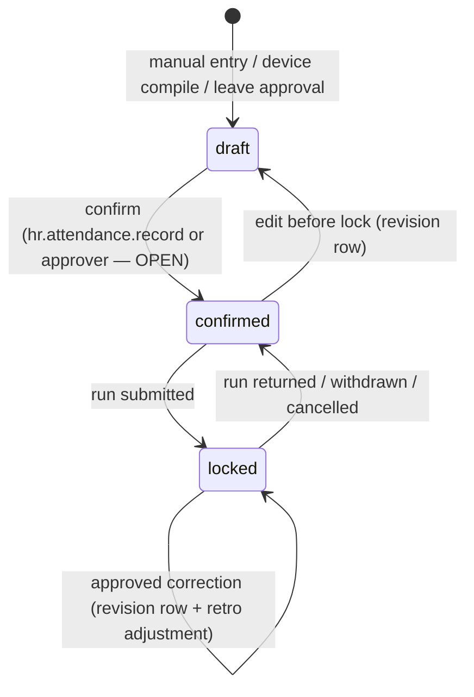

# UNITED ERP — HR & Payroll: Capability Audit and Architecture Proposal

| | |
|---|---|
| Status | **Schema proposal approved ("go", 28 Oct 2026). Phases 1–5 implemented locally — see §0.** Phase 6 (posting and payments) and Phase 7 are not built: they wait on the decisions in §12. Nothing is committed, pushed or deployed; migrations were applied to the local test database only. §1–§12 below are the proposal as approved and are kept unchanged as the design record. |
| Date | 28 October 2026 |
| Source of truth | The working tree (six local commits `4c948a3` … `ffb297a` plus uncommitted work), read file by file. Model, field, setting and function names marked **(existing)** were verified in the repository; names marked **(proposed)** do not exist yet. |
| Decision labels used below | **APPROVED** = decided by the business owner in the request of 28 Oct 2026 · **PROPOSED** = design in this document, not approved · **ASSUMPTION** = working assumption, to be confirmed · **OPEN** = needs an explicit decision (owner, accountant or HR) before the related phase starts |

## 0. Implementation record (after approval, 28 Oct 2026)

Built on the local test database only (PostgreSQL 16, `united_test`); nothing committed, pushed or deployed. Every phase: migration wrapped in `BEGIN`/`COMMIT`, applied with `prisma migrate deploy`, and `prisma migrate diff --from-migrations … --to-schema-datamodel … --exit-code` = 0 (no drift).

### 0.1 Migrations

| Migration | Phase | Adds |
|---|---|---|
| `20261028120000_hr_employee_foundation` | 1 | `EmployeeEmployment` (append-only, non-overlapping, one open row; backfilled one row per employee), `EmployeePrivateInfo`, `EmployeeBankAccount`, `EmployeeDocument`, `Department.managerEmployeeId`, 5 HR attachment categories |
| `20261028130000_hr_attendance` | 2 | `WorkSchedule` + `WorkScheduleDay`, `PublicHoliday`, `AttendanceDay` (+ revision required per version, locked days change only through a correction), `AttendanceDayRevision` (append-only), `AttendanceCorrection` (requester ≠ decider CHECK), device seam `AttendanceSource` / `AttendanceIdentity` / `AttendanceEvent` (append-only, idempotent per event id) / `AttendanceImportBatch`; integration scope `attendance.ingest`; seeds only the `manual` source |
| `20261028140000_hr_leave` | 3 | `LeaveType`, `LeavePolicy` (draft → verified by another person → retired; never edited once verified; no overlap) + `LeavePolicyTier`, `LeaveLedgerEntry` (append-only, sign per kind, idempotent per source), `LeaveRequest` (no overlap, recorder ≠ decider CHECK); `AttendanceDay.leaveRequestId` FK |
| `20261028150000_hr_compensation` | 4 | `PayComponent` (inactive until taxable + insurable decided), `EmployeeCompensation` + lines (proposer ≠ approver CHECK; approved packages never overlap or change), `StatutoryRuleSet` (verified by another person; no overlap per code; frozen once verified) |
| `20261028160000_hr_payroll_runs` | 5 | `PayrollRun` (one regular run per month; approver ≠ preparer and ≠ submitter CHECK; frozen figures once submitted), `PayrollRunEmployee`, `PayrollRunLine` (frozen once submitted), `PayrollCalculationSnapshot` (append-only), `PayrollAdjustment` (on one payslip at most); `EmployeeTransaction.type = salary_on_account` + `payrollPeriod`; `AttendanceDay.lockedRunId` FK |

No statutory value, leave entitlement, schedule, pay component or account mapping is seeded by any migration.

### 0.2 Capability status after phases 1–5

Status uses §1's classification (**IT** = implemented and covered by an automated end-to-end test).

| Area | Capability | Status | Evidence |
|---|---|---|---|
| Organisation | Department manager | **IT** | `tests/hr-foundation.test.ts` |
| Lifecycle | Effective-dated history: transfer, promotion, status change, contract change, termination (reason required), re-hire; same-day supersede kept and marked | **IT** | `tests/hr-foundation.test.ts` §1–3 (48 checks) |
| Personal data | Private file (national ID unique, insurance, tax no., birth date, emergency contact), read audited, field names only in audit | **IT** | `tests/hr-foundation.test.ts` §5 |
| | Bank accounts: replaced never edited, masked in lists, audited reveal | **IT** | §6 |
| | Document register with expiry on employee attachments | **IT** | §7 |
| Time | Work schedules (per weekday, break, night window) assigned through employment history | **IT** | `tests/hr-attendance.test.ts` §1, §3 (104 checks) |
| | Public holidays with reference; removal refused once relied on | **IT** | §2, §11 |
| | Daily register: draft → confirmed; measured worked / late / early / outside-schedule minutes per class (day, night, rest day, holiday); night shift across midnight | **IT** | §4–6 |
| | Revision trail: every version has its revision row (DB-enforced) | **IT** | §5, §9 |
| | Corrections approved by someone else; locked days only through corrections; retro marker for posted runs | **IT** | §7–8; `tests/hr-payroll.test.ts` §8 |
| | Device seam: per-device integration key, idempotent ingestion, identity mapping, compile to drafts that never overwrite a person's entry | **IT** | `tests/hr-attendance.test.ts` §10 (no physical device connected) |
| Leave | Types, verified policies with service/age tiers, idempotent allocation, adjustments with reason, balances from the ledger, requests counted on the schedule and holidays, approval writing the ledger and confirmed leave days atomically, cancellation reversing both, documents required per type | **IT** | `tests/hr-leave.test.ts` (69 checks) |
| Compensation | Component catalogue, packages proposed/approved by different people, closing the previous package, salary confidentiality on the server | **IT** | `tests/hr-payroll.test.ts` §1–2 |
| Statutory | Rule sets per code with structure validation, source required, second-person verification, frozen once verified | **IT** (framework) | §5 — **no real values entered**; see §7 |
| Money during the month | Salary paid on account of a month (posted like an advance) and recovered in full by that month's run | **IT** | §3, §6 |
| | Recovery of ordinary advances through payroll | **P** | amount entered per payslip by the preparer, capped at the open advance and the net; the automatic rule (instalment plans, §3.7) is open (P5) |
| Payroll | Run: create (one regular per month), calculate (every calculation kept), validation exceptions (blocking / warning), holds with reason, one-off adjustments reserved on one payslip | **IT** | §4, §6 |
| | Refuses to calculate figures no verified rule covers | **IT** | §4 |
| | Submit freezes figures and locks the month's attendance; approval only by someone who neither prepared nor submitted; refused if a fresh calculation differs; return, withdraw, reopen, cancel | **IT** | §7–8 |
| | Posting, payments, payslip print, reversal / correction runs, reconciliation | **M** | Phase 6 — needs §12 A1–A4 |
| Reporting | Payroll register, cost by department | **M** | Phase 7 |

### 0.3 Where the build differs from the proposal (and why)

- **Payroll adjustments have no approval of their own.** Each one is a separate line on the payslip the approver must approve with the run, so the four-eyes rule still covers it; a second approval step was not added (`PayrollAdjustment.status`: open → reserved → applied/cancelled).
- **Advance recovery reservations** are the payslip's `advanceRecovery` figure (capped against the open 1600 balance minus recoveries already counted by other live runs). The proposed `AdvanceRecovery` table with its cap trigger belongs to posting (Phase 6), when recoveries become ledger entries.
- **Leave:** half days, carry-over/expiry jobs and encashment are not built (fields exist on the policy). Cancelling a leave whose days a payroll run has locked is refused until posting exists; unpaid leave is stored as `status = leave` with the type's pay mode deciding the deduction.
- **Attendance status `absent`** is not deducted; only `absent_unpaid` and unpaid / partially paid leave are. Payroll reports `absent` days as a warning.
- **Suspended days and joiners' / leavers' social insurance** are reported as warnings for a human decision; the engine does not prorate insurance or decide suspension pay.
- **Statutory rule editing** is a JSON form with a key-only template (every value empty). Structured per-rule forms are a candidate UI improvement.
- **Lint:** `npm run lint` fails before and after this work with `next lint` / ESLint 9 option errors (tooling, not code); CI does not run it.

### 0.4 Permissions as implemented (role defaults are the OPEN P1–P3 decisions; one option shown)

SUPER_ADMIN holds everything. ACCOUNTANT gains `hr.employees.view`, `hr.leave.request`, `hr.compensation.view`, `hr.compensation.manage`, `hr.payroll.prepare`, `hr.payroll.view`, `hr.statutory.manage`. SUPERVISOR gains `hr.attendance.record`. Private data, leave/attendance approval, leave configuration and payroll approval stay with SUPER_ADMIN until P1–P3 are decided — so today the owner approves what finance prepares, and the database refuses anyone approving their own work.

---

Contents: 1 Capability matrix · 2 Approved requirements · 3 Proposed data model · 4 Lifecycles · 5 Accounting integration · 6 RBAC & confidentiality · 7 Egyptian statutory decision register · 8 Odoo benchmark · 9 Phased implementation & migrations · 10 Rollback & recovery · 11 Acceptance criteria & test plan · 12 Open decisions

---

## 1. Current capability matrix and evidence

Classification: **IT** implemented and tested end to end · **P** partially implemented · **M** missing · **PR** proposed in this document, not approved or implemented. A table, route or screen on its own is never counted as IT; IT requires an automated test or a recorded browser check of the whole workflow.

### 1.1 What exists today (verified in code)

| Layer | Present |
|---|---|
| Schema (existing) | `Department` (`code` unique, `name`, `active`), `Employee` (`code` `EMP-#####`, `name`, `departmentId`, `jobTitle`, `phone`, `userId` unique, `hireDate`, `active`, `version`), `Expense`, `EmployeeTransaction` (`type` ∈ advance / reimbursement / advance_return; append-only trigger) |
| DB guarantees (existing) | `Employee_values` CHECK (code shape, non-empty name); `EmployeeTransaction_values` CHECK; `EmployeeTransaction_append_only` trigger; `JournalLine.partyType` may be `employee`; RLS enabled on all four tables |
| Service (existing) | `lib/hr/service.ts`: `saveDepartment` (create/rename/close with guard), `saveEmployee` (partial update, optimistic version, audited), `listEmployees(actor)` (field projection by permission), `createExpense` + `applyExpenseDecision` (approval engine type `hr.expense`), `createEmployeeTransaction` (advance / reimbursement / advance return, posted to the ledger, over-payment guards, no new advance to an inactive employee), `employeeStatement` (read from the journal) |
| API (existing) | `GET/POST /api/hr/employees`, `PATCH /api/hr/employees/:id`, `GET /api/hr/employees/:id/statement`, `POST /api/hr/departments`, `GET/POST /api/hr/expenses`, `GET /api/hr/expense-accounts`, `POST /api/hr/transactions` |
| Accounting (existing) | `acc_1600` *Employee advances* (`employee_advances`), `acc_2300` *Employee reimbursements payable* (`employee_payable`), `acc_6300` *Salaries and wages* (`salaries` — exists, nothing posts to it) |
| Permissions (existing) | `hr.employees.manage`, `hr.expenses.submit`, `hr.expenses.approve`, `hr.advances.manage`. ACCOUNTANT holds manage/submit/advances; SUPERVISOR holds submit; SUPER_ADMIN holds all. There is no HR role. |
| UI (existing) | `/hr`: expenses (form + filtered table), employee register (search, status filter, add/edit/deactivate dialog, statement dialog, advance/payment dialog), departments (add, rename, close/reopen) |
| Tests (existing) | `tests/hr.test.ts` — 38 checks: RBAC, threshold approval, segregation on expense approval, journal posting, reimbursement/return caps, statement, confidentiality projection, partial edit, stale version, department close guard, audit rows, inactive-advance refusal |

### 1.2 Matrix

| Area | Capability | Status | Evidence / gap |
|---|---|---|---|
| Organisation | Departments: create, rename, close (refused with active employees), reopen, audited | **IT** | `tests/hr.test.ts` §5; browser check |
| | Department manager / organisation chart | **M** → PR §3.2 | no field |
| | Job positions (catalogue) | **P** | `Employee.jobTitle` free text; a catalogue is **not recommended** for UNITED's size (§3.2) |
| | Reporting lines (employee → manager) | **M** → PR §3.2 | no field |
| Lifecycle | Hire (create employee with code) | **IT** | `tests/hr.test.ts` §1 |
| | Edit details (partial, versioned) | **IT** | §5 |
| | Deactivate / reactivate | **IT** (flag only) | §5; no reason, no date |
| | Employment history (effective-dated transfers, promotions, status) | **M** → PR §3.2 | only current values on `Employee` |
| | Termination (date, reason, final settlement) | **M** → PR §3.2, §4.6 | |
| | Re-hire | **M** → PR §3.2 | |
| | Employment contracts (type, start/end, probation) | **M** → PR §3.2 | |
| Personal data | National ID, birth date, insurance number, tax identifiers | **M** → PR §3.3 | none stored |
| | Bank details for salary transfer | **M** → PR §3.3 | |
| | Employee documents (ID copy, contract, insurance forms) with expiry | **M** → PR §3.3 | `Attachment` exists but `employee` is not an attachment entity and the category CHECK has no HR categories |
| | Confidentiality of financial data | **IT** (balances/phones only) | `listEmployees` projection; `tests/hr.test.ts` §4 |
| Access | Employee ↔ user link | **P** | `Employee.userId` column + unique guard; no screen; HR roles cannot list users |
| | Role permissions for HR/payroll | **P** | four permissions above; no payroll, attendance, leave or private-data permissions |
| Time | Work schedules / shifts | **M** → PR §3.4 | |
| | Public holidays | **M** → PR §3.4 | |
| | Manual attendance entry | **M** → PR §3.4 | |
| | Attendance corrections with approval and history | **M** → PR §3.4 | |
| | Device (biometric) ingestion seam | **M** → PR §3.4 | |
| | Overtime capture (day / night / rest day) | **M** → PR §3.4 | |
| Leave | Leave types, policies, balances (ledger), requests, approval, accrual | **M** → PR §3.5 | |
| Compensation | Pay component catalogue | **M** → PR §3.6 | |
| | Effective-dated salary per employee | **M** → PR §3.6 | |
| | Allowances, deductions, bonuses (recurring and one-off) | **M** → PR §3.6 | |
| Money during the month | Advances (cash out, return, ledger) | **IT** | `tests/hr.test.ts` §3 |
| | Partial salary payments during the month | **M** → PR §3.7 | today only possible as an "advance" with no link to the month's salary |
| | Advance recovery through payroll (once, capped) | **M** → PR §3.7 | recovery only by cash return |
| | Instalment plans for larger advances / loans | **M** → PR §3.7 | |
| Payroll | Monthly run: prepare, calculate, validate, submit | **M** → PR §3.8, §4.1 | |
| | Approval with preparer ≠ approver | **M** → PR §4.1 | the approval engine (existing) can refuse self-approval **only when** the global setting `approvals.require_different_approver` is on, and it is **off by default** — payroll must enforce this itself |
| | Posting to the ledger, once | **M** → PR §5 | the ledger (existing) already guarantees one entry per (`sourceType`,`sourceId`) |
| | Payment (full / partial), capped at approved net | **M** → PR §3.9 | pattern exists for suppliers (`SupplierPayment` + `PaymentAllocation` + cap trigger) |
| | Payslips (bilingual print) | **M** → PR §11 UI | |
| | Corrections after posting (reversal / correction run) | **M** → PR §4.1 | |
| | Reconciliation (payroll vs GL, per employee) | **M** → PR §5.6 | `lib/accounting/integrity.ts` (existing) checks AR/AP/inventory; no payroll checks |
| Statutory | Income tax, social insurance, other funds | **M** → PR §3.10, §7 | no verified rules (§7) |
| | Statutory reports / submissions | **M** → OPEN §7 | |
| Reporting | Payroll register, cost by department, employee history | **M** → PR §9 Phase 7 | |
| Audit | Audit rows for employee/department/expense/advance | **IT** | `writeAudit` calls; department audit asserted in `tests/hr.test.ts` §5 |
| Localisation | Arabic RTL / English LTR on HR screens | **IT** (current screens) | screenshots + raw-key scan; `tests/unit/ui-dictionary-keys.test.ts` |
| Self-service | Employee sees own payslips / requests leave | **M** → PR (Phase 7, optional) | employees mostly do not have user accounts today |

---

## 2. Approved requirements (APPROVED, 28 Oct 2026)

1. Build a complete HR and payroll system from the beginning — not a minimal add-on.
2. Start with **manual attendance entry**, with an integration seam for future biometric devices.
3. **Monthly** payroll.
4. Employee **advances and partial payments during the month**, reconciled accurately against the employee's monthly net entitlement.
5. **Segregation of duties:** whoever prepares a payroll run must not approve that run.
6. Preserve UNITED's workflows, accounting engine, inventory/operations modules, RBAC, audit trails, Arabic RTL and English LTR.

Constraints for this phase (APPROVED): documentation only; no schema, migration, code, production, commit, push or deploy.

---

## 3. Proposed data model (PROPOSED)

### 3.0 Conventions every proposed table follows (taken from the existing code)

- Primary keys `String @id @default(cuid())`; money `Decimal(18,2)`; day and hour quantities `Decimal(8,2)`; dates as `String` `YYYY-MM-DD` checked by regex (as `Expense.date`, `JournalEntry.date` do); instants as `DateTime`.
- `version Int` for optimistic locking on every mutable row (as `Employee`, `ApprovalRequest`).
- `createdById`/`createdBy` on every row (as `Expense`); audit through `writeAudit` (existing) with new `entityType` values added to the `AuditInput` union.
- Business numbers from `nextDocumentNumber` (existing `lib/core/sequences.ts`). New sequence keys (proposed): `hr.payroll_run` → `PRL`, `hr.payslip` → `PSL`, `hr.payroll_payment` → `SPY`, `hr.leave_request` → `LVR`, `hr.attendance_correction` → `ATC`, `hr.payroll_adjustment` → `PAD`. `PAY` is already taken by supplier payments and must not be reused.
- Idempotency: `idempotencyKey String? @unique` + `requestHash` with `lockKey`/`replayRequest` (existing `lib/core/idempotency.ts`) on every create that moves money or changes a run's state.
- Every new table: `ENABLE ROW LEVEL SECURITY` in its migration (existing convention, 90 such statements in `prisma/migrations`).
- Foreign keys `ON DELETE RESTRICT`. **Nothing that has fed a posted payroll is ever deleted**; rows are deactivated, cancelled, superseded or reversed.
- Append-only tables reuse the existing `sales_append_only()` trigger function, as `EmployeeTransaction` does.

### 3.1 Reused existing models (no change in meaning)

| Existing model | Role in HR/payroll |
|---|---|
| `Employee` | The person. Stays the single employee master; `Employee.departmentId`, `jobTitle` and `active` remain the **current** values, kept equal to the current `EmployeeEmployment` row by the service (checked by the integrity report, §5.6). |
| `Department` | Organisation unit. |
| `User` | Login account; linked through `Employee.userId` (existing). |
| `EmployeeTransaction` | Advances, reimbursements, returns — **extended** (§3.7), not duplicated. |
| `Attachment` | Employee documents (bytes and hashes) — reused through a new entity mapping and categories (§3.3). |
| `ApprovalRequest` / `ApprovalDecision` | Approvals for attendance corrections, leave, compensation changes, adjustments and payroll runs (new `APPROVAL_TYPES` entries). |
| `JournalEntry` / `JournalLine` / `Account` / `AccountingPeriod` / `CashAccount` | All accounting; `JournalLine.partyType = 'employee'` (existing) gives the per-employee subledger. |
| `SystemSetting` | Company-policy switches (payday, cut-off, recovery defaults) through the settings registry (existing). |
| `AuditLog` | History of every change. |

### 3.2 Employment and organisation

**`EmployeeEmployment` (proposed)** — effective-dated employment record.
- Purpose: who the employee works for, where, as what, from when to when. Owner: HR.
- Fields: `id`, `employeeId` → `Employee`, `effectiveFrom` (date), `effectiveTo` (date, null = open), `event` (`hire | transfer | promotion | status_change | contract_change | termination | rehire`), `departmentId` → `Department` (nullable), `jobTitle` (text), `managerEmployeeId` → `Employee` (nullable, reporting line), `employmentType` (`permanent | fixed_term | daily | part_time` — values OPEN, company policy), `contractStart`, `contractEnd` (nullable), `probationEnd` (nullable), `workScheduleId` → `WorkSchedule` (nullable), `status` (`active | suspended | terminated`), `terminationReason` (nullable, required when `terminated`), `reason` (text), `createdById`, `createdBy`, `createdAt`.
- Constraints: CHECK date shapes; `effectiveTo IS NULL OR effectiveTo >= effectiveFrom`; `status = 'terminated'` ⇒ `terminationReason` present; `managerEmployeeId <> employeeId`. Non-overlap per employee enforced by a trigger (no `btree_gist` dependency). Index `(employeeId, effectiveFrom)`.
- Lifecycle: append-only. A change closes the open row (`effectiveTo` set — the only permitted update, enforced by trigger) and inserts a new one in the same transaction. Rows are never deleted.
- Integration: `saveEmployee` (existing) writes the current values onto `Employee` in the same transaction; payroll reads the row in force on each day of the period (mid-month transfers and terminations are prorated, §4.4).
- Confidentiality: not sensitive except `terminationReason` (HR only).

**`Department.managerEmployeeId` (proposed column, nullable)** → `Employee`. Used for leave and attendance-correction routing (OPEN: whether managers approve, §12).

**Job positions:** a `JobPosition` catalogue is **not proposed** now. Free-text `jobTitle` is enough for UNITED's head-count; revisit when budgeted head-count or grade bands are required.

### 3.3 Confidential personal, statutory and bank data

**`EmployeePrivateInfo` (proposed)** — 1:1 with `Employee`, separate table so that ordinary employee queries can never select it.
- Fields: `employeeId` (PK, FK), `nationalId` (text, checked for format only after HR confirms it — OPEN), `birthDate`, `gender` (only if needed for a statutory leave type — OPEN), `nationality`, `insuranceNumber`, `insuranceStartDate`, `taxRegistrationNo` (nullable, OPEN whether used), `address`, `emergencyContactName`, `emergencyContactPhone`, `version`, `updatedById`, `updatedAt`.
- Constraints: `nationalId` unique where not null. Data minimisation: only fields with a confirmed statutory or operational use are added (OPEN, §12).
- RBAC: read `hr.private.view`; write `hr.private.manage`. Every read through the API writes an audit row (`employee_private_viewed`) — access logging, not only change logging.

**`EmployeeBankAccount` (proposed)**
- Fields: `id`, `employeeId`, `bankName`, `accountNumber`, `iban` (nullable), `holderName`, `isPrimary`, `effectiveFrom`, `verifiedById`, `verifiedAt`, `active`, `createdById`, `createdAt`.
- Constraints: one primary active account per employee (partial unique index `(employeeId) WHERE isPrimary AND active`).
- Lifecycle: changes deactivate the old row and create a new one; a change made within N days of a payment date raises a warning in the payroll workspace (fraud control; N is OPEN).
- RBAC: `hr.private.view` / `hr.private.manage`; numbers masked (`•••• 1234`) except to `hr.payroll.pay` when exporting a payment file.

**Employee documents** — reuse `Attachment` (existing):
- Add `employee` to `ATTACHMENT_ENTITIES` (existing `lib/core/attachment-entities.ts`) with view `hr.private.view`, manage `hr.private.manage`.
- Extend the `Attachment_category_known` CHECK with `id_document`, `employment_contract`, `insurance_form`, `certificate`, `medical` (replace-constraint migration; existing categories unchanged).
- **`EmployeeDocument` (proposed)**, only for metadata attachments cannot hold: `attachmentId` (unique FK), `employeeId`, `docType`, `documentNumber` (masked on display), `issueDate`, `expiryDate`, `createdById`. An expiry list feeds an HR reminder.

### 3.4 Schedules, holidays and attendance

**`WorkSchedule` (proposed)**: `code` unique, `nameAr`, `nameEn`, `weeklyHours`, `active`, `version`.
**`WorkScheduleDay` (proposed)**: `scheduleId`, `weekday` 0–6, `isWorkingDay`, `start` (`HH:MM`), `end`, `breakMinutes`, `nightStart`/`nightEnd` (the night-work window — values OPEN, §7). Unique `(scheduleId, weekday)`. Time zone fixed to Africa/Cairo (existing deployment convention).
**`PublicHoliday` (proposed)**: `date` unique, `nameAr`, `nameEn`, `paid`, `reference` (decree / announcement — entered by HR), `createdById`.

**`AttendanceDay` (proposed)** — the payroll's source of truth, one row per employee per day.
- Fields: `id`, `employeeId`, `date`, `status` (`present | absent | absent_unpaid | leave | holiday | rest_day | suspended`), `firstIn`, `lastOut` (`DateTime`, nullable), `workedMinutes`, `lateMinutes`, `earlyLeaveMinutes`, `overtimeDayMinutes`, `overtimeNightMinutes`, `overtimeRestDayMinutes`, `overtimeHolidayMinutes`, `leaveRequestId` (nullable), `source` (`manual | device | correction | leave | system`), `state` (`draft | confirmed | locked`), `lockedRunId` (nullable → `PayrollRun`), `notes`, `version`, `enteredById`, `enteredBy`, `updatedAt`.
- Constraints: unique `(employeeId, date)`; minutes ≥ 0; `state = 'locked'` ⇔ `lockedRunId IS NOT NULL`; trigger refuses any update of a locked row except through the correction path (§4.3).
- **`AttendanceDayRevision` (proposed)**, append-only: `attendanceDayId`, `revision`, `before` (JSON), `after` (JSON), `reason`, `changedById`, `changedBy`, `changedAt`, `correctionId` (nullable). Every change to a day writes one revision, so "who changed what, when, why" is always answerable.
- Overtime is recorded as **minutes per class**; pay multipliers are statutory/policy inputs (§3.10, §7), not stored on the day.

**`AttendanceCorrection` (proposed)** — a request to change a confirmed or locked day.
- Fields: `number` (`ATC-`), `employeeId`, `date`, `requested` (JSON of proposed values), `reason` (required), `status` (`pending | approved | rejected | cancelled`), `approvalRequestId`, `appliedRevision` (nullable), `retroAdjustmentId` (nullable → `PayrollAdjustment`), `requestedById`, `createdAt`, `version`.
- Approval type (proposed) `hr.attendance_correction`, permission `hr.attendance.approve`.

**Device seam (proposed, built in Phase 2 but not connected to any device):**
- **`AttendanceSource` (proposed)**: `code` unique (e.g. `manual`, `zk-gate-1`), `kind` (`manual | device | import_file`), `active`, `credentialRef` (reference to an `Integration` (existing) row — devices authenticate as integrations, so keys, logging and revocation are reused).
- **`AttendanceIdentity` (proposed)**: `sourceId`, `externalUserId`, `employeeId`; unique `(sourceId, externalUserId)`. Maps device badge or user numbers to employees without putting device fields on `Employee`.
- **`AttendanceEvent` (proposed)**, append-only raw punches: `sourceId`, `externalEventId`, `externalUserId`, `employeeId` (nullable until mapped), `occurredAt`, `direction` (`in | out | unknown`), `payload` (JSON, raw), `batchId`, `receivedAt`. Unique `(sourceId, externalEventId)` makes re-delivery idempotent.
- **`AttendanceImportBatch` (proposed)**: `sourceId`, `receivedAt`, `eventCount`, `status`, `error`.
- A *compile* step (service, not a DB rule) turns mapped events into `AttendanceDay` rows with `source = device` and `state = draft`; humans confirm. Device data never overwrites a `manual` or `correction` value without a revision row. A future adapter only has to post events to an ingestion endpoint; nothing device-specific enters the core model.

### 3.5 Leave

**`LeaveType` (proposed)**: `code` unique, `nameAr`, `nameEn`, `payMode` (`paid | unpaid | partially_paid`), `paidPercent` (nullable, required for `partially_paid`), `countsDays` (`working | calendar`), `requiresAttachment`, `allowNegativeBalance`, `affectsAttendanceStatus` (maps to `AttendanceDay.status = leave` or `absent_unpaid`), `active`.

**`LeavePolicy` (proposed)**, effective-dated, **values entered by HR after §7 decisions; nothing is hard-coded**: `leaveTypeId`, `effectiveFrom`, `effectiveTo`, `accrualMethod` (`none | annual_upfront | monthly | per_worked_day`), `carryOverMaxDays`, `carryOverExpiryMonths`, `status` (`draft | verified | retired`), `verifiedById`, `sourceReference`.
**`LeavePolicyTier` (proposed)**: `policyId`, `minServiceMonths`, `minAge` (nullable), `employeeCategory` (nullable), `daysPerYear`. A tier table, because the reported rules (§7) depend on service length, age and category.

**`LeaveLedgerEntry` (proposed)**, append-only — the balance is the sum, never a stored number: `employeeId`, `leaveTypeId`, `date`, `kind` (`allocation | accrual | taken | taken_reversal | carry_over | expiry | adjustment | encashment`), `days` (signed `Decimal(6,2)`), `sourceType`, `sourceId`, `createdById`. Unique `(sourceType, sourceId, kind)` makes accrual jobs and approvals idempotent.

**`LeaveRequest` (proposed)**: `number` (`LVR-`), `employeeId`, `leaveTypeId`, `startDate`, `endDate`, `startHalf`/`endHalf` (bool), `days` (snapshot computed with the schedule and holidays in force), `reason`, `status` (`draft | pending | approved | rejected | cancelled`), `approvalRequestId`, `requestedById`, `version`. Trigger refuses overlapping `pending`/`approved` requests for the same employee. Documents attach through `Attachment` with entity `leave_request`.

### 3.6 Compensation

**`PayComponent` (proposed)** — the catalogue: `code` unique (`BASIC`, `HOUSING`, `TRANSPORT`, `OT_DAY`, `OT_NIGHT`, `BONUS`, `UNPAID_ABSENCE`, `SI_EMPLOYEE`, `SI_EMPLOYER`, `INCOME_TAX`, `ADVANCE_RECOVERY`, `ROUNDING`, … — the list is OPEN), `nameAr`, `nameEn`, `kind` (`earning | deduction | employer_contribution | information`), `method` (`fixed | input | attendance | statutory | system`), `expenseAccountId` → `Account` (earnings, employer contributions), `liabilityAccountId` → `Account` (deductions, contributions), `taxable` and `insurable` (**nullable; a component cannot be activated until the accountant sets both** — §7), `payslipOrder`, `active`.

**`EmployeeCompensation` (proposed)** — effective-dated package header: `employeeId`, `effectiveFrom`, `effectiveTo`, `insurableWage` (entered, not derived — OPEN §7), `reason`, `status` (`draft | pending | approved | superseded`), `approvalRequestId`, `createdById`, `version`. Non-overlap per employee for `approved` rows (trigger).
**`EmployeeCompensationLine` (proposed)**: `compensationId`, `payComponentId`, `amount` (monthly), unique `(compensationId, payComponentId)`; only `fixed`-method components allowed.
- Changes go through approval type (proposed) `hr.compensation_change` with `hr.compensation.manage` to propose and `hr.payroll.approve` to approve (OPEN who).
- RBAC: read `hr.compensation.view`; never returned by the employee directory API.
- A salary-structure *template* (Odoo-style) is **not proposed**: UNITED pays monthly with a handful of components; a "copy from employee" action in the UI covers it.

### 3.7 Advances, partial payments during the month, and recovery

UNITED needs two different things that both move cash to an employee before payroll (APPROVED §2.4):

| | Advance / loan | Partial salary payment during the month |
|---|---|---|
| Meaning | Money lent, recovered over one or more months | Part of *this month's* salary paid early |
| Existing support | `EmployeeTransaction` `type = 'advance'` → Dr 1600 / Cr cash (existing) | none |
| Proposed | unchanged + optional instalment plan | new `EmployeeTransaction.type = 'salary_on_account'` with a required `payrollPeriod` |
| Recovery | per plan or per run (policy OPEN) | **must** be fully recovered in that period's regular run |

Proposed changes to the existing model (additive):
- `EmployeeTransaction.payrollPeriod String?` (`YYYY-MM`), required when `type = 'salary_on_account'` (CHECK).
- Replace `EmployeeTransaction_values` CHECK so `type` also allows `salary_on_account` (existing values unchanged).
- Posting for `salary_on_account` is identical to `advance` (Dr 1600 employee advances, party = employee / Cr cash or bank), so the employee statement (existing) keeps working. The type only adds the obligation and the period.

**`AdvanceRepaymentPlan` (proposed)**: `employeeTransactionId` (unique), `instalmentAmount`, `firstPeriod`, `status` (`active | completed | cancelled`), `approvedById`. It drives the *suggested* recovery per run; HR may change the amount on a run with a reason (recorded on the recovery row).

**`AdvanceRecovery` (proposed)** — the allocation of an advance to a payslip:
- Fields: `employeeTransactionId` → `EmployeeTransaction` (type `advance` or `salary_on_account`), `runEmployeeId` → `PayrollRunEmployee`, `amount` > 0, `status` (`reserved | applied | released`), `reason` (when it differs from the plan), `createdAt`.
- Guarantees:
  - Deferred constraint trigger (mirroring the existing `accounting_allocation_cap()`): Σ(`reserved` + `applied`) per advance ≤ advance amount − Σ cash returns allocated to it.
  - Partial unique index `(employeeTransactionId, runEmployeeId) WHERE status <> 'released'` — the same advance cannot be applied twice to one payslip.
  - At posting, recovery per employee ≤ that employee's open balance on 1600 (read from the journal, as `employeeStatement` does).
- Lifecycle: `reserved` at calculation → `applied` at posting (immutable from then on) → `released` only when a run is cancelled before posting. A reversal of a posted run creates compensating rows; applied rows are never edited.
- Cash returns (`advance_return`, existing) are matched to the oldest open advance (FIFO) when no advance is specified — OPEN whether to allow explicit matching.

### 3.8 Payroll runs, payslips and the calculation snapshot

**`PayrollRun` (proposed)**
- Fields: `id`, `number` (`PRL-YYYY-#####`), `period` (`YYYY-MM`), `runType` (`regular | off_cycle | correction`), `correctionOfRunId` (nullable), `status` (§4.1), `attendanceFrom`, `attendanceTo` (cut-off — OPEN policy), `postingDate` (default: last day of `period` — OPEN), `preparedById` (who created the run and last calculated it), `submittedById`, `submittedAt`, `approvalRequestId`, `approvedById`, `approvedAt`, `postedById`, `postedAt`, `journalEntryId` (unique), `reversalJournalEntryId` (unique, nullable), `totals` (`gross`, `employeeDeductions`, `employerContributions`, `advanceRecovery`, `netPayable`, `headcount`), `calculationHash`, `engineVersion`, `idempotencyKey` (unique), `requestHash`, `cancelledReason`, `version`, timestamps.
- Constraints:
  - Partial unique index `(period) WHERE runType = 'regular' AND status <> 'cancelled'` — **one regular run per month**.
  - CHECK `approvedById IS NULL OR (approvedById <> preparedById AND approvedById <> submittedById)` — the **database** refuses self-approval, independent of the global approval setting.
  - CHECK `runType = 'correction'` ⇔ `correctionOfRunId IS NOT NULL`.
  - CHECK status ↔ timestamp consistency (e.g. `posted` ⇒ `journalEntryId` present).
- Lifecycle: §4.1. Never deleted; `cancelled` before posting, `reversed` after.

**`PayrollRunEmployee` (proposed)** — the payslip header.
- Fields: `runId`, `employeeId`, `number` (`PSL-`), `inclusion` (`included | on_hold | excluded`), `holdReason`, `employmentSnapshot` (JSON: department, title, schedule, employment rows in force with their date ranges), `compensationId`, `inputsSnapshot` (JSON: compensation lines, attendance summary per class, leave days per type, adjustments, advances, statutory rule-set ids + versions, holidays used), `gross`, `employeeDeductions`, `employerContributions`, `netEntitlement` (= gross − employee deductions), `advanceRecovery`, `netPayable` (= net entitlement − advance recovery), `inputsHash`, `version`.
- Constraints: unique `(runId, employeeId)`; CHECK `netPayable = netEntitlement − advanceRecovery`; CHECK `netPayable >= 0` (a negative net is a validation exception, not a payslip — OPEN carry-forward rule §12).

**`PayrollRunLine` (proposed)** — one computed line.
- Fields: `runEmployeeId`, `payComponentId`, `code`, `nameAr`, `nameEn`, `kind` (snapshots), `quantity`, `rate`, `base`, `amount` (always ≥ 0; the sign comes from `kind`), `sourceType` (`compensation | attendance | leave | adjustment | advance_recovery | statutory | rounding`), `sourceId`, `ruleSetId`, `ruleSetVersion`, `explanation` (short human formula, both languages).
- Freeze: a trigger refuses insert/update/delete when the run's status is beyond `calculated`. Recalculation in `draft`/`calculated` replaces the lines inside one transaction; the old lines are kept as the previous calculation snapshot (`PayrollCalculationSnapshot` below), so nothing is silently lost.

**`PayrollCalculationSnapshot` (proposed)**, append-only: `runId`, `sequence`, `calculationHash`, `totals`, `lines` (compressed JSON of every payslip), `calculatedById`, `calculatedAt`. Every calculation is kept, so the approved figures can be compared with earlier drafts and reproduced.

**`PayrollAdjustment` (proposed)** — one-off or retroactive inputs (bonus, one-off allowance, manual deduction, correction from an earlier month).
- Fields: `number` (`PAD-`), `employeeId`, `targetPeriod`, `payComponentId`, `quantity`/`amount`, `reason` (required), `origin` (`manual | attendance_correction | leave_change | prior_run_correction`), `originId`, `status` (`pending | approved | rejected | reserved | applied | released`), `approvalRequestId`, `reservedRunEmployeeId`, `appliedRunEmployeeId`, `createdById`, `version`.
- Exactly-once: `reservedRunEmployeeId` is set at calculation inside the run's transaction; the status machine plus partial unique index `(id) WHERE status IN ('reserved','applied')` mean an adjustment sits on at most one payslip; cancelling a run releases it.

**Validation exceptions** (computed, not stored as a table; surfaced in the workspace and blocking submission when severity = error), for example: employee active in the period without approved compensation; attendance days still `draft`; overlapping leave and attendance; required statutory rule set not `verified`; negative net; bank account changed within N days; employee terminated mid-period without a final-settlement decision; recovery exceeding open advance.

### 3.9 Payroll payments

**`PayrollPayment` (proposed)** — money out against posted payslips (mirrors `SupplierPayment`, existing).
- Fields: `number` (`SPY-YYYY-#####`), `date`, `cashAccountId` → `CashAccount`, `method` (`cash | bank_transfer | cheque | wallet`), `amount` > 0, `reference`, `notes`, `idempotencyKey` (unique), `requestHash`, `createdById`, `createdBy`, `createdAt`. Append-only.

**`PayrollPaymentAllocation` (proposed)**: `paymentId`, `runEmployeeId`, `amount` > 0. Append-only. Two deferred constraint triggers:
1. Σ allocations per payment = `PayrollPayment.amount`.
2. Σ allocations per `runEmployeeId` (net of reversed payments) ≤ `PayrollRunEmployee.netPayable` — **paying more than the approved amount is impossible at the database level**.

**`PayrollPaymentReversal` (proposed)**: `paymentId` (unique), `date`, `reason`, `createdById` — the existing `SupplierPaymentReversal` pattern; one reversal per payment.

### 3.10 Statutory rules (configurable, effective-dated, verified before use)

**`StatutoryRuleSet` (proposed)**
- Fields: `code` (`eg_social_insurance`, `eg_salary_income_tax`, `eg_other_levies`, `eg_overtime`, … — OPEN list), `effectiveFrom`, `effectiveTo`, `parameters` (JSON validated by a per-code zod schema: rates, caps, brackets, exemptions, rounding), `sourceReference` (law / decree / circular number, article, publication date — **required**), `status` (`draft | verified | retired`), `verifiedById`, `verifiedAt`, `version`.
- Constraints: non-overlapping `verified` rows per `code` (trigger). Verifying needs `hr.statutory.manage` and a different person from the creator (CHECK).
- **Hard rule:** a payroll calculation that needs a rule set for its period refuses to run unless a `verified` row covers the whole period. Unverified figures therefore cannot reach a payslip.
- Each payslip line records `ruleSetId` + `version` (§3.8), so a later change of rates never alters a posted calculation.

### 3.11 Relationships (overview)

```mermaid
erDiagram
  Employee ||--o{ EmployeeEmployment : "history"
  Employee ||--o| EmployeePrivateInfo : "confidential"
  Employee ||--o{ EmployeeBankAccount : ""
  Employee ||--o{ AttendanceDay : ""
  AttendanceDay ||--o{ AttendanceDayRevision : ""
  Employee ||--o{ AttendanceCorrection : ""
  AttendanceSource ||--o{ AttendanceEvent : ""
  AttendanceSource ||--o{ AttendanceIdentity : ""
  LeaveType ||--o{ LeavePolicy : ""
  LeavePolicy ||--o{ LeavePolicyTier : ""
  Employee ||--o{ LeaveRequest : ""
  Employee ||--o{ LeaveLedgerEntry : ""
  Employee ||--o{ EmployeeCompensation : ""
  EmployeeCompensation ||--o{ EmployeeCompensationLine : ""
  PayComponent ||--o{ EmployeeCompensationLine : ""
  Employee ||--o{ EmployeeTransaction : "advances (existing)"
  EmployeeTransaction ||--o| AdvanceRepaymentPlan : ""
  EmployeeTransaction ||--o{ AdvanceRecovery : ""
  PayrollRun ||--o{ PayrollRunEmployee : "payslips"
  PayrollRun ||--o{ PayrollCalculationSnapshot : ""
  PayrollRunEmployee ||--o{ PayrollRunLine : ""
  PayrollRunEmployee ||--o{ AdvanceRecovery : ""
  PayrollRunEmployee ||--o{ PayrollPaymentAllocation : ""
  PayrollPayment ||--o{ PayrollPaymentAllocation : ""
  PayrollPayment ||--o| PayrollPaymentReversal : ""
  PayrollRun }o--|| JournalEntry : "posting (existing)"
  StatutoryRuleSet ||--o{ PayrollRunLine : "rule used"
```

---

## 4. Lifecycles (PROPOSED)

### 4.1 Payroll run

```mermaid
stateDiagram-v2
  [*] --> draft: create (hr.payroll.prepare)
  draft --> calculated: calculate
  calculated --> calculated: recalculate (new snapshot)
  calculated --> draft: reopen inputs
  calculated --> pending_approval: submit (no blocking exceptions)
  pending_approval --> calculated: returned by approver (reason required)
  pending_approval --> approved: approve (approver ≠ preparer, ≠ submitter)
  approved --> calculated: approval withdrawn before posting (reason)
  approved --> posted: post (period open; one journal)
  posted --> partially_paid: payment allocation
  partially_paid --> paid: allocations = net payable
  partially_paid --> posted: all payments reversed
  paid --> partially_paid: a payment reversed
  draft --> cancelled
  calculated --> cancelled
  posted --> reversed: reverse (no live payments)
  reversed --> [*]
  cancelled --> [*]
  paid --> [*]
```

| State | Allowed changes | Not allowed |
|---|---|---|
| `draft` | edit inclusion, inputs, adjustments, holds; recalculate | — |
| `calculated` | everything in draft; lines are replaced by recalculation (old snapshot kept) | submit with blocking exceptions |
| `pending_approval` | nothing on the figures; approver may approve or return | any input change (attendance in the period is locked; corrections go to §4.3) |
| `approved` | post, or withdraw approval (back to `calculated`) | any change to lines |
| `posted` | payments, payment reversals, run reversal (when no live payments) | any change to lines, recoveries or adjustments |
| `partially_paid` / `paid` | payments up to the cap, payment reversals | run reversal (reverse the payments first) |
| `reversed` / `cancelled` | none (terminal); a correction run or a new regular run may be created | — |

Rules:
1. **Segregation:** `approve` is refused when the actor is `preparedById` or `submittedById` (service check + DB CHECK §3.8). If only one person holds both permissions, the run cannot be approved — intentional (OPEN: who the second person is, §12).
2. **Freeze:** at `submit`, the run takes `calculationHash` over the payslip inputs and lines and locks every `AttendanceDay` in the period for the included employees (`state = locked`, `lockedRunId`). `approve` re-computes the hash and refuses if it differs (a tampered or stale calculation can never be approved).
3. **Amendment after approval or posting** is never an edit:
   - before posting: withdraw approval → `calculated` → recalculate → submit again (new approval).
   - after posting: (a) **correction run** (`runType = correction`) carrying only delta lines, own approval, own journal, in an open period — preferred; or (b) **reverse** the run (only with no live payments), which posts a reversal entry and releases recoveries/adjustments, then a new regular run for the period.
4. `cancelled` is possible only before posting and releases all reservations (`AdvanceRecovery`, `PayrollAdjustment`) and unlocks attendance.

### 4.2 Transaction boundaries, idempotency and recovery

| Step | One DB transaction containing | Locks (always in this order) | Idempotency |
|---|---|---|---|
| Create run | run row, audit | `payroll-period:{YYYY-MM}` | `idempotencyKey`; partial unique index on regular run per period |
| Calculate | delete+insert lines, reservations of adjustments and advances, snapshot row, totals, audit | `payroll-run:{id}`, then each `employee-advance:{id}` (sorted) | re-running gives the same hash with unchanged inputs |
| Submit | status, hash, attendance lock, approval request (`requestApproval`, existing) | `payroll-run:{id}` | the approval engine returns the pending request if it already exists (existing behaviour) |
| Approve | decision row (engine), status, hash re-check | engine lock, `payroll-run:{id}` | `ApprovalDecision` unique `(requestId, level)` (existing) |
| Post | journal (`postJournal`, existing), run status, `AdvanceRecovery` → applied, adjustments → applied, audit | `payroll-run:{id}`, then `accounting-period:{YYYY-MM}` (taken inside `ensureOpenPeriod`, existing) | `JournalEntry_one_per_source` unique index (existing) on (`payroll_run`, runId) — a second post fails at the database |
| Pay | payment, allocations, journal, run status recomputed | `payroll-run:{id}` (each run touched, sorted), period lock | payment `idempotencyKey` + cap triggers |
| Reverse | reversal journal (`payroll_run_reversal`, runId), status, release/compensate recoveries and adjustments | as Post | one-per-source index on (`payroll_run_reversal`, runId) — a run reverses once |

- **Failure behaviour:** every step is one transaction; the existing deferred `JournalLine_balanced` trigger and the proposed cap triggers run at commit. If anything fails, nothing is written — the run keeps its previous status and the ledger is untouched. There is no "half-posted" state to repair.
- **Retry:** a client retry with the same key returns the first result (`replayRequest`, existing).
- **Recovery check:** the integrity report (§5.6) lists any run whose status and journal disagree. By construction this should be empty; the check exists to prove it.

### 4.3 Attendance

- Every change writes an `AttendanceDayRevision` (before/after/reason/who/when).
- **Corrections after lock:** an `AttendanceCorrection` is approved (`hr.attendance.approve`). The day is updated with a revision. The payroll effect of the *difference* between what the locked run used (stored in its `inputsSnapshot`) and the corrected day becomes a `PayrollAdjustment` with `origin = attendance_correction` for the **next** open run. The posted run is never touched.

### 4.4 Leave

```mermaid
stateDiagram-v2
  [*] --> draft
  draft --> pending: submit
  pending --> approved: approve (hr.leave.approve)
  pending --> rejected: reject (reason)
  pending --> cancelled: withdraw
  approved --> cancelled: cancel (reason; before or after start — OPEN)
```

- Approval writes `LeaveLedgerEntry` (`taken`, negative days) and sets the affected `AttendanceDay` rows (`status = leave`, or `absent_unpaid` for unpaid types) in one transaction.
- Cancelling an approved leave writes `taken_reversal` and restores the days. If those days are already locked by a run, the payroll effect becomes a retro `PayrollAdjustment` (`origin = leave_change`), as in §4.3.
- Accruals run as an idempotent job writing `accrual` rows keyed by `(policy, employee, period)`; with `accrualMethod = none` nothing accrues automatically. Amounts come only from `verified` `LeavePolicy` rows (§7).

### 4.5 How attendance, leave, overtime and absence feed payroll

For each included employee and each day of the period (calendar days of `period`, or the cut-off window `attendanceFrom..attendanceTo` — OPEN), the engine reads the employment row, the approved compensation and the attendance day, then:

| Input | Effect (formula parameters are OPEN, §7 and §12) |
|---|---|
| Employment not active on a day (joined late, left early, suspended) | proration of fixed components; method (calendar days vs 30-day month vs working days) is an OPEN decision |
| `absent_unpaid`, unpaid leave | deduction line `UNPAID_ABSENCE` (quantity = days, rate = daily rate by the agreed method) |
| Partially paid leave | deduction for the unpaid share, per `LeaveType.paidPercent` |
| Overtime minutes per class | earning lines `OT_DAY`, `OT_NIGHT`, `OT_REST`, `OT_HOLIDAY` with multipliers from a verified `eg_overtime` rule set or a company-policy rule (whichever is higher — OPEN) |
| Approved `PayrollAdjustment` for the period | its line, reserved to this payslip |
| Open advances / `salary_on_account` for the period | `ADVANCE_RECOVERY` (amount from plan / mandatory full recovery for on-account payments, never above the open balance) |
| Statutory rule sets | `SI_EMPLOYEE`, `SI_EMPLOYER`, `INCOME_TAX`, other levies — only from `verified` rule sets |

### 4.6 Termination and final settlement

A termination is an `EmployeeEmployment` row (`event = termination`). The next run prorates to the termination date and lists the employee with a blocking exception until HR records the final-settlement decision (unused-leave encashment, end-of-service amounts, open advances). What is legally due is OPEN (§7); the system computes nothing it has not been told.

---

## 5. Accounting integration (PROPOSED — no journal created, ledger code unchanged)

### 5.1 What the existing ledger already guarantees (verified)

- `postJournal(tx, …)` (`lib/accounting/ledger.ts`) posts one balanced entry inside the caller's transaction and calls `ensureOpenPeriod`. That takes the advisory lock `accounting-period:{YYYY-MM}` and refuses a closed period.
- Database: `JournalEntry_one_per_source` (unique `(sourceType, sourceId)` except `manual`/`reversal`); `JournalEntry_append_only`; `JournalLine_guard` (append-only, postable and active accounts only); `JournalEntry_period_open` (no insert into a closed period); deferred `JournalLine_balanced`.
- `JournalEntry_values` CHECK enumerates the allowed `sourceType` values. Its latest version is in migration `20261009090000_party_refunds`.
- Document reversals use their own source type and table (`receipt_reversal`/`CustomerReceiptReversal`, `payment_reversal`/`SupplierPaymentReversal`), not `reverseJournal`, which only reverses `manual` entries.
- `JournalLine_one_side` allows `partyType` ∈ `customer`, `supplier`, `employee`.

### 5.2 Chart of accounts: verified and proposed

Verified in `prisma/migrations/20261008164713_accounting_core` and `lib/core/reference-data.ts`. Codes in use in the seeded chart: 1000, 1100, 1200, 1300, 1400, 1500, **1600** (employee advances), 2000, 2100, 2150, 2200, **2300** (employee reimbursements payable), 3000, 3100, 3200, 3300, 4000, 4100, 4200, 5000, 5100, 5200, 5300, 6000, 6100, 6200, **6300** (salaries and wages). Accounts can also be created at run time (`createAccount`, existing), so **the production chart may contain codes that are not in the seed; it must be read before the migration** (Phase 6 pre-check).

The earlier draft's codes 2400/2410/2420/6310 are withdrawn as a fixed choice. Proposed mapping, placed next to the existing employee liability (2300); every code and name is OPEN for the accountant:

| Proposed system key | Proposed code | Type | Name (EN / AR) | Purpose |
|---|---|---|---|---|
| `salaries_payable` | 2310 | liability | Net salaries payable / صافي مرتبات مستحقة | net pay owed per employee (party = employee) |
| `payroll_si_payable` | 2320 | liability | Social insurance payable / تأمينات اجتماعية مستحقة | employee + employer social insurance owed to the authority |
| `payroll_tax_payable` | 2330 | liability | Salary tax withheld payable / ضريبة كسب عمل مستحقة | income tax withheld |
| `payroll_other_payable` | 2340 | liability | Other payroll deductions payable / استقطاعات أخرى مستحقة | other statutory funds and third-party deductions |
| `employer_si_expense` | 6310 | expense | Employer social insurance / حصة الشركة في التأمينات | employer contribution expense |
| (existing) `salaries` | 6300 | expense | Salaries and wages | gross earnings (or split by component account) |
| (existing) `employee_advances` | 1600 | asset | Employee advances | advances and on-account payments; recovered through payroll |
| *optional* `leave_provision` / `eos_provision` | 2350 / 2360 + 6320 / 6330 | liability / expense | Leave and end-of-service provisions | only if the accountant decides to provision monthly (OPEN) |

Migration rule (Phase 6): insert with explicit ids (`acc_2310`…) **only if neither the code nor the system key exists**; if the code is taken by another account, the migration stops with an error rather than overwriting.

### 5.3 Journal per event

Amounts per employee use `party = { type: 'employee', id }` on the payable and advance lines, so the per-employee subledger works as it does for advances today.

| Event | Debit | Credit | `sourceType` (proposed) |
|---|---|---|---|
| **Payroll posted** (date = run `postingDate`) | 6300 gross earnings (one line per component expense account) · 6310 employer contributions | 2320 employee + employer social insurance · 2330 income tax withheld · 2340 other deductions · 1600 advance recovery (party) · 2310 net payable (party) | `payroll_run` / runId |
| **Payment** (full or partial) | 2310 (party) | cash/bank account of the `CashAccount` | `payroll_payment` / paymentId |
| **Payment reversal** | cash/bank | 2310 (party) | `payroll_payment_reversal` / reversalId |
| **Run reversal** (no live payments) | mirror of the posting: every line of the original, debits and credits swapped, same parties | | `payroll_run_reversal` / runId |
| **Correction run** | delta lines only (may be debit or credit per component) | | `payroll_run` / correction runId |
| Advance / on-account payment (existing) | 1600 (party) | cash/bank | `employee_transaction` (existing) |
| Remittance of SI / tax to the authorities | 2320 / 2330 / 2340 | cash/bank | OPEN: manual journal (existing) or a new remittance document |

Balance identity: gross + employer contributions = SI (employee + employer) + tax + other deductions + advance recovery + net payable. The posting rule asserts it before calling `postJournal`, and the database checks it again at commit.

Required ledger-side changes (Phase 6, additive): add the four source types to the `SourceType` union and replace the `JournalEntry_values` CHECK with the list extended by `payroll_run`, `payroll_run_reversal`, `payroll_payment`, `payroll_payment_reversal`. Existing values stay unchanged. No change to `postJournal`, period logic or existing posting rules.

### 5.4 Partial payments and advances, reconciled against the month's net (APPROVED §2.4)

Example: net entitlement 10,000; on-account payment of 3,000 on the 15th; advance balance 2,000 recovered at 1,000 per month.

| When | Entry | 1600 (employee) | 2310 (employee) |
|---|---|---|---|
| 15th | on-account payment: Dr 1600 3,000 / Cr cash | +3,000 → 5,000 incl. old advance | — |
| Payroll posted | … Cr 1600 4,000 (3,000 on-account + 1,000 instalment) · Cr 2310 6,000 | 1,000 left (the loan) | 6,000 |
| 30th | payment 6,000: Dr 2310 / Cr bank | | 0 |

The payslip shows: net entitlement 10,000 − on-account paid 3,000 − advance instalment 1,000 = **6,000 to pay**. Overpayment is impossible: recovery ≤ open balance (§3.7), payments ≤ net payable (§3.9).

### 5.5 Closed periods and posting date

- The posting date is the run's `postingDate` (default the last day of the period — OPEN). If that accounting period is closed, posting is refused by `ensureOpenPeriod` and the DB trigger (existing). Payroll never re-dates silently.
- A correction to a closed month is posted as a correction run in the current open period; the payroll register shows both the period it corrects and the period it was posted in.
- Payments post on their own date, which must be in an open period.

### 5.6 Reconciliation checks (added to `integrityReport`, existing)

1. Per employee: GL balance of 2310 = Σ `netPayable` of posted, non-reversed payslips − Σ live payment allocations.
2. Per employee: GL balance of 1600 = Σ advances and on-account payments − Σ returns − Σ applied recoveries (extends the existing `employeeStatement` logic).
3. Every `posted`/`paid`/`partially_paid` run has exactly one `payroll_run` journal whose total equals the run totals, and every `reversed` run has exactly one reversal journal.
4. Run status agrees with allocations (`paid` ⇔ Σ allocations = Σ net payable).
5. GL 2320/2330/2340 = Σ posted deductions − Σ remittances (once remittances exist).
6. `Employee.departmentId`/`jobTitle`/`active` equal the current `EmployeeEmployment` row.
7. No `salary_on_account` transaction for a period whose regular run is posted remains unrecovered.

### 5.7 Statutory calculation vs accounting

The **statutory engine** (§3.10) decides *how much* tax, social insurance and levies are due, using verified rule sets. The **accounting rule** above only decides *where* those amounts are booked. Changing a rate never touches the posting rule; changing an account never touches a calculation.

---

## 6. RBAC and confidentiality

### 6.1 Proposed permissions (new keys; the existing four are kept)

| Permission (proposed) | Grants |
|---|---|
| `hr.employees.view` | directory: name, code, department, title, status |
| `hr.employees.manage` (existing) | create/edit employees and departments, employment history |
| `hr.private.view` / `hr.private.manage` | national ID, birth date, insurance number, bank accounts, employee documents |
| `hr.attendance.record` | enter and confirm attendance, import device files |
| `hr.attendance.approve` | approve attendance corrections |
| `hr.leave.request` | create leave requests (for self, or for others with `hr.employees.manage`) |
| `hr.leave.approve` | approve or reject leave |
| `hr.leave.configure` | leave types and policies |
| `hr.compensation.view` / `hr.compensation.manage` | salaries and compensation history / propose changes |
| `hr.payroll.prepare` | create, calculate and submit runs; holds and adjustments |
| `hr.payroll.approve` | approve or return runs (never one's own, §4.1) |
| `hr.payroll.post` | post an approved run to the ledger |
| `hr.payroll.pay` | record payroll payments; export payment files |
| `hr.payroll.view` | read runs, payslips and the register |
| `hr.statutory.manage` | create and verify statutory rule sets (creator ≠ verifier) |
| `hr.self.view` (optional, Phase 7) | an employee's own payslips and leave balance |

The existing `tests/unit/rbac-snapshot.test.ts` requires `docs/erp/rbac-snapshot.json` to be regenerated in the same change.

### 6.2 Proposed role mapping (OPEN — owner decides; one option shown)

| Permission group | SUPER_ADMIN | ACCOUNTANT | SUPERVISOR | **HR_OFFICER (proposed new role, OPEN)** |
|---|---|---|---|---|
| Directory view | ✓ | ✓ | ✓ (names only) | ✓ |
| Employees manage | ✓ | ✓ (today) | — | ✓ |
| Private data | ✓ | — | — | ✓ |
| Attendance record | ✓ | — | ✓ (own teams — OPEN) | ✓ |
| Attendance approve | ✓ | — | ✓ (OPEN) | — |
| Leave approve | ✓ | — | ✓ (OPEN) | ✓ |
| Compensation view / manage | ✓ | ✓ / — | — | ✓ / ✓ |
| Payroll prepare | — (recommended) | ✓ | — | ✓ |
| Payroll approve | ✓ | — | — | — |
| Payroll post | ✓ | ✓ | — | — |
| Payroll pay | ✓ | ✓ | — | — |
| Statutory rules | ✓ (verify) | ✓ (create) | — | — |

With this option, preparation sits with accounting or HR, approval with the owner (SUPER_ADMIN), and posting and payment with accounting. A SUPER_ADMIN who prepares a run still cannot approve it (§4.1).

### 6.3 Confidentiality rules (API first, UI second)

1. **Field projection on the server** (existing pattern `listEmployees(actor)`): every HR endpoint builds its response from the caller's permissions. Salary, bank and identity fields are never serialised for a caller without the permission. Hiding them only in the UI is not acceptable.
2. **Separate tables** for private data, bank data and compensation, so an unrelated query (`include: { employee: true }`) can never carry them.
3. **Access logging:** reads of private data, bank numbers and individual payslips write audit rows. Exports (CSV, payment files, payslip PDFs) are audited with the requester and row count.
4. **Notifications and approval summaries never contain salary figures.** A payroll approval request shows the run number, headcount and total only to holders of `hr.payroll.approve`.
5. **Audit visibility:** extend `lib/security/audit-visibility.ts` (existing) so payroll, compensation and private-data audit rows are visible only to holders of the matching view permissions.
6. **Attachments:** `employee` attachments are gated by `hr.private.view` (§3.3).
7. **Self-service** (Phase 7): an employee sees only rows where `Employee.userId = session user`, enforced in the query, not by filtering after loading.

---

## 7. Egyptian statutory decision register

**Source access in this session.** The official hosts needed for primary verification — the Egyptian Tax Authority (`eta.gov.eg`), the National Organization for Social Insurance (`nosi.gov.eg`), the Ministry of Labour (`manpower.gov.eg`), the Ministry of Finance (`mof.gov.eg`) and the ILO NATLEX database (`natlex.ilo.org`) — were **not reachable**: the session's network policy refused the connections. No official text, gazette or circular was read. Two kinds of source were available:
- **Secondary:** law-firm notes and payroll-vendor guides found by web search (cited below; they disagree with each other in places).
- **Vendor product documentation:** Odoo 19 "Egypt payroll localization" page, read from Odoo's official documentation source ([raw GitHub](https://raw.githubusercontent.com/odoo/documentation/19.0/content/applications/hr/payroll/payroll_localizations/egypt.rst)). It describes how Odoo's product calculates; it is **not** a legal source.

**Every statutory item below is UNVERIFIED and requires confirmation by the accountant / HR against the official text before any value enters a `StatutoryRuleSet` (§3.10).** The figures are recorded only so the professionals know what to check.

| # | Item | What the accessible sources report | Source quality | Status | To be confirmed by | Official source to check (not accessed) |
|---|---|---|---|---|---|---|
| S1 | Governing labour law | Labour Law No. 14 of 2025 replaces Law 12/2003, in force 1 Sep 2025 ([EY](https://www.ey.com/en_gl/technical/tax-alerts/egypt-enacts-new-labor-law-with-changes-affecting-employers-beginning-1-september-2025), [S&P](https://www.shandpartners.com/insights/firm-news/new-labour-law-no-14-of-2025/)) | secondary, consistent | UNVERIFIED | HR / legal counsel | Official Gazette text of Law 14/2025 and its executive decrees |
| S2 | Annual leave | 15 days in the first year, 21 from the second year, 30 after 10 years' service or age 50; 45 for employees with disabilities ([AMERELLER](https://amereller.com/publication/egypt-new-labor-law-no-14-of-2025/), [EY](https://www.ey.com/en_gl/technical/tax-alerts/egypt-enacts-new-labor-law-with-changes-affecting-employers-beginning-1-september-2025)); sources **disagree** on the 6-month vs 1-year threshold ([Lexology](https://www.lexology.com/library/detail.aspx?g=842cf812-8c1e-49d4-bfaa-e6401b47b5d2)). Odoo's product page uses a flat 21 days. | secondary, conflicting; vendor differs | UNVERIFIED | HR | Law 14/2025, leave chapter |
| S3 | Sick leave pay | Odoo's product page: 100% for 30 days, 75% next 60, 0% after 90 | vendor documentation only | UNVERIFIED | HR | Law 14/2025 and the social-insurance law (who pays sick pay, for how long) |
| S4 | Working hours | 8 h/day, 48 h/week; daily-cap rules changed — sources **disagree** ([Careerians](https://www.careerians.com/egyptian-labor-law/egypt-new-labor-law-20-key-changes/), [Staffona](https://staffona.com/resources/labor-law)) | secondary, conflicting | UNVERIFIED | HR | Law 14/2025, working-time chapter |
| S5 | Overtime pay and night window | At least +35% day / +70% night; rest days and holidays disputed (+100% per Odoo's product page; other sources silent or different); notice to the Ministry within 7 days ([Lexology](https://www.lexology.com/library/detail.aspx?g=842cf812-8c1e-49d4-bfaa-e6401b47b5d2)). The hours that count as "night" were not found. | secondary + vendor, partly conflicting | UNVERIFIED | HR + accountant | Law 14/2025, overtime articles; ministerial decrees |
| S6 | Social insurance rates | Employer 18.75%, employee 11% of insurable wage ([Ramco](https://www.ramco.com/payce/payroll-compliance-egypt), [Staffona](https://staffona.com/resources/social-insurance-egypt-guide); same in Odoo's product page) | secondary + vendor, consistent | UNVERIFIED | Accountant | Law 148/2019 and NOSI decisions |
| S7 | Insurable wage limits and their annual revision | 2026: minimum EGP 2,700 / maximum EGP 16,700, revised each January ([Lexcouncil](https://lexcouncil.com/en/tools/social-insurance-calculator), [Staffona](https://staffona.com/resources/social-insurance-egypt-guide)) | secondary | UNVERIFIED | Accountant | NOSI annual decision for the year |
| S8 | Definition of insurable wage (which components count) | not established by any accessible source | — | OPEN | Accountant | Law 148/2019 |
| S9 | Other levies (emergency fund, martyrs' fund, …) | 1% and 0.05% reported; sources **disagree** on who pays ([Staffona](https://staffona.com/resources/social-insurance-egypt-guide)) | secondary, conflicting | UNVERIFIED | Accountant | Founding laws of each fund |
| S10 | Salary income tax brackets | Law 91/2005 as amended by Law 7/2024: 0% to EGP 40,000, then 10 / 15 / 20 / 22.5 / 25 / 27.5% bands, with higher earners losing the lower bands ([A-H-G](https://www.a-h-g.net/en/income-tax-law-amendments-in-2024/), [Flick](https://www.flick.network/en-eg/egypt-personal-income-tax-guide); Odoo's product page has the same table); the high-earner rule is described **differently** by different sources | secondary + vendor, partly conflicting | UNVERIFIED | Accountant | Law 7/2024 and the executive regulations |
| S11 | Personal exemption | EGP 20,000 per year ([Flick](https://www.flick.network/en-eg/egypt-personal-income-tax-guide); Odoo's product page) | secondary + vendor | UNVERIFIED | Accountant | Law 91/2005 as amended |
| S12 | Order of calculation (SI before tax; monthly vs annualised withholding; rounding) | one secondary source: SI deducted first, annual tax computed and divided by 12 | secondary, single source | UNVERIFIED | Accountant | ETA guidance on salary-tax withholding |
| S13 | Tax and SI treatment of each allowance, bonus and overtime | not established | — | OPEN | Accountant | as S8, S10 |
| S14 | Unpaid leave and absence deduction method (÷30, calendar days, working days) | Odoo's product page uses monthly salary ÷ 30 | vendor only | OPEN | HR + accountant | Law 14/2025 + company policy |
| S15 | End-of-service benefits and leave encashment on termination | Odoo's product page provisions both from contract-entered day counts | vendor only | OPEN | HR + legal counsel | Law 14/2025 |
| S16 | Statutory annual increment | one source claims a minimum annual increment under Law 14/2025; not corroborated | secondary, single source | UNVERIFIED | HR / legal | Law 14/2025 |
| S17 | Required payroll records, payslip fields, retention periods | not established | — | OPEN | HR + accountant | Law 14/2025; ETA and NOSI filing rules |
| S18 | Statutory submissions (monthly/quarterly/annual tax and SI filings, formats, deadlines) | not established | — | OPEN | Accountant | ETA and NOSI portals |
| S19 | Special categories (disability, minors, foreign employees, daily/seasonal workers) | partial mentions only (leave for disability) | secondary | OPEN | HR | Law 14/2025 |

**Company-policy decisions (not statutory)** — owner and accountant; see §12: payday, cut-off dates, proration method where the law leaves a choice, advance and on-account limits and recovery schedule, approval hierarchy, who may see salaries, overtime eligibility and pre-approval, rounding of net pay, payment methods, handling of negative net pay.

---

## 8. Odoo capability benchmark

**Access:** `www.odoo.com` is blocked in this session. The benchmark therefore uses **Odoo's official documentation source repository for version 19.0** (`github.com/odoo/documentation`, fetched as raw files), which is the content published on odoo.com/documentation. Only pages that were actually fetched are cited. Standard capabilities and the Egypt localization are listed separately.

### 8.1 Standard product (Odoo 19.0)

| Odoo capability (source page) | What it does (from the page) | UNITED decision |
|---|---|---|
| Employees ([employees.rst](https://raw.githubusercontent.com/odoo/documentation/19.0/content/applications/hr/employees.rst)) — new employee, departments, onboarding/offboarding, skills, equipment, certifications | full employee master and lifecycle | **Adopt** master, departments, lifecycle (§3.2–3.3); **skip** skills, equipment, certifications, learning |
| Contracts ([payroll/contracts.rst](https://raw.githubusercontent.com/odoo/documentation/19.0/content/applications/hr/payroll/contracts.rst)) — contract templates, schedule, employer costs, benefits and deductions | contract carries wage, structure and schedule | **Simplify:** `EmployeeEmployment` + `EmployeeCompensation`; no templates |
| Salary structures and rules ([payroll.rst](https://raw.githubusercontent.com/odoo/documentation/19.0/content/applications/hr/payroll.rst) toctree: salaries, salary_rules) | rule engine per structure | **Skip** a general rule engine; fixed components + a small statutory engine with verified, dated parameters (§3.6, §3.10) |
| Work entries ([payroll/work_entries.rst](https://raw.githubusercontent.com/odoo/documentation/19.0/content/applications/hr/payroll/work_entries.rst)) — types, conflicts with time off, regeneration | time pieces feeding payslips | **Simplify** to `AttendanceDay` per day with classes of minutes; conflicts become validation exceptions |
| Payslips ([payroll/payslips.rst](https://raw.githubusercontent.com/odoo/documentation/19.0/content/applications/hr/payroll/payslips.rst)) — worked days, salary inputs, computation, validate, payment report, post journal entry, pay, refund (negative payslip) | full payslip cycle | **Adopt** the cycle; **differ** on correction: UNITED uses correction runs / reversal entries, consistent with its append-only ledger |
| Pay runs ([payroll/pay_runs.rst](https://raw.githubusercontent.com/odoo/documentation/19.0/content/applications/hr/payroll/pay_runs.rst)) — group payslips per period, statuses Ready/Done/Paid, totals | batch processing | **Adopt** as `PayrollRun`, with a stricter state machine and maker-checker (not described on the page) |
| Salary adjustments ([payroll/salary_attachments.rst](https://raw.githubusercontent.com/odoo/documentation/19.0/content/applications/hr/payroll/salary_attachments.rst)) — attachment/assignment of salary, child support, recurring amounts | recurring deductions | **Adopt partially:** `AdvanceRepaymentPlan` + `PayrollAdjustment`; garnishment types only if needed |
| Attendances ([attendances.rst](https://raw.githubusercontent.com/odoo/documentation/19.0/content/applications/hr/attendances.rst)) — check-in/out, kiosks, approvers, logs, overtime | presence capture | **Adopt manual first** (APPROVED); kiosk/badge ([hardware](https://raw.githubusercontent.com/odoo/documentation/19.0/content/applications/hr/attendances/hardware.rst)) later through the device seam |
| Overtime rulesets ([attendances/overtime.rst](https://raw.githubusercontent.com/odoo/documentation/19.0/content/applications/hr/attendances/overtime.rst)) — none preconfigured; rate combination modes | configurable overtime | **Adopt** as classes of minutes + verified multipliers; no rule builder |
| Time off ([time_off.rst](https://raw.githubusercontent.com/odoo/documentation/19.0/content/applications/hr/time_off.rst)) — types, accrual plans, public holidays, mandatory days, allocations, requests, management | full leave | **Adopt** types, policies with tiers, ledger, requests, holidays; **skip** mandatory days for now |
| Accrual plans ([time_off/accrual_plans.rst](https://raw.githubusercontent.com/odoo/documentation/19.0/content/applications/hr/time_off/accrual_plans.rst)) | earn leave over time | **Adopt** a reduced set of accrual methods (§3.5) |
| Accounting integration (payslips page: "Post the journal entry" before "Pay") | payroll journal + payment | **Adopt** the same order, using UNITED's existing ledger guarantees |

### 8.2 Egypt localization (Odoo product)

[payroll_localizations/egypt.rst](https://raw.githubusercontent.com/odoo/documentation/19.0/content/applications/hr/payroll/payroll_localizations/egypt.rst): modules `l10n_eg_hr_payroll` and `l10n_eg_hr_payroll_account`. It covers:
- social insurance from a per-contract reference amount (18.75% / 11%);
- annual leave of 21 days, sick-leave tiers, and unpaid leave at monthly ÷ 30;
- progressive income tax brackets with the high-earner columns and a 20,000 exemption;
- overtime at 1.35 / 1.70 / 2.0;
- monthly provisions for end of service and annual leave;
- end-of-service settlement and out-of-contract days.

Use for UNITED: a **checklist of topics** the accountant must rule on (§7 S2–S15). Its figures are not adopted as rules. Odoo states them as product behaviour, and some differ from other sources (for example S2 leave entitlement).

### 8.3 Deliberately not proposed (unnecessary complexity for UNITED now)

Multi-company payroll, multiple pay frequencies, generic salary-rule scripting, contract templates and e-signature, commissions, recruitment, appraisals, skills, fleet, equipment, expense-to-payslip reimbursement (UNITED already settles expenses through `employee_payable`), kiosk hardware in phase 1.

---

## 9. Phased implementation and migration plan (PROPOSED — nothing executed)

General rules:
- Each phase ships as one Prisma migration plus code. Migrations are additive: new tables, nullable columns, new CHECK values. Replacing a CHECK only ever *adds* allowed values.
- The application of the previous release must keep working against the migrated schema; new tables are unused until the new code is deployed.
- Deployment order every time: **backup → apply migration → verify → deploy application → enable the feature** (setting `hr.payroll_enabled`, proposed, default off).
- Every phase adds its tests to the existing CI workflow (`.github/workflows/ci.yml`).

| Phase | Adds | Depends on (existing) | Compatibility / backfill | Integrity checks after migration | Rollback before data is used | Rollback after data is used |
|---|---|---|---|---|---|---|
| **0 Prerequisites** | nothing in the schema; decisions §12 S/P items for phases 1–3; production chart-of-accounts read; backup and restore drill | — | — | restore drill passes: row counts, `integrityReport` ok, full test suite against the restored copy | — | — |
| **1 Employee foundation** | `EmployeeEmployment`, `EmployeePrivateInfo`, `EmployeeBankAccount`, `EmployeeDocument`, `Department.managerEmployeeId`; `Attachment` category CHECK extended; `employee` attachment entity; new HR permissions; optional `HR_OFFICER` role | `Employee`, `Department`, `Attachment`, `User` | backfill one `EmployeeEmployment` (`event = hire`, `effectiveFrom = hireDate ?? createdAt date`) per existing employee, mirroring current department, title and status | every employee has exactly one open employment row matching `Employee` | drop new tables/column; restore the old CHECK (no existing rows use the new categories) | do not drop: export, disable the feature, keep the tables. Private data must be **exported securely before** any drop |
| **2 Time** | `WorkSchedule`, `WorkScheduleDay`, `PublicHoliday`, `AttendanceDay`, `AttendanceDayRevision`, `AttendanceCorrection`, `AttendanceSource`, `AttendanceIdentity`, `AttendanceEvent`, `AttendanceImportBatch`; approval type `hr.attendance_correction` | Phase 1, `Integration`, approvals | no backfill; a `manual` source row is seeded | none beyond constraints | drop tables | keep tables (attendance is payroll evidence) |
| **3 Leave** | `LeaveType`, `LeavePolicy`, `LeavePolicyTier`, `LeaveLedgerEntry`, `LeaveRequest`; approval type `hr.leave` | Phases 1–2 | opening balances entered as ledger `allocation` rows with a source document (HR sign-off) | Σ ledger = displayed balance | drop tables | keep tables (balances are entitlements) |
| **4 Compensation & statutory** | `PayComponent`, `EmployeeCompensation`, `EmployeeCompensationLine`, `StatutoryRuleSet`; approval type `hr.compensation_change` | Phase 1, `Account` | salaries entered and approved per employee; statutory rule sets entered and verified (§7) | every active employee has approved compensation before Phase 5 goes live | drop tables | keep (salary history is a legal record — S17) |
| **5 Payroll runs (no posting)** | `PayrollRun`, `PayrollRunEmployee`, `PayrollRunLine`, `PayrollCalculationSnapshot`, `PayrollAdjustment`, `AdvanceRepaymentPlan`; approval type `hr.payroll_run`; states up to `approved` only | Phases 1–4 | **parallel run** for at least two months against the current payroll process; differences explained and signed off | engine reproduces the hash for every recalculation; parallel-run reconciliation report | drop tables (no ledger impact yet) | keep runs as evidence of the parallel run |
| **6 Accounting & payments** | new accounts (§5.2, conditional insert); `SourceType` union + `JournalEntry_values` CHECK extended; `EmployeeTransaction.payrollPeriod` + type CHECK extended (`salary_on_account`); `AdvanceRecovery`; `PayrollPayment`, `PayrollPaymentAllocation`, `PayrollPaymentReversal` with cap triggers; integrity checks §5.6 | Phase 5, ledger | none; first live month chosen with the accountant; accounts verified free in production first | `integrityReport` all green after the first posting and the first payment | **only before the first posting:** drop new tables, restore previous CHECKs, deactivate (not delete) the new accounts if they have no lines | **no schema rollback** — see §10 |
| **7 Reporting & self-service** | payroll register, cost by department, SI/tax schedules (format after S18), bilingual payslip print, optional `hr.self.view` | Phases 1–6 | — | report totals = GL totals for the period | remove UI | — |

---

## 10. Rollback and recovery plan

1. **Backups:** before every phase migration, a full logical backup and confirmation that point-in-time recovery is enabled (see `docs/erp/BACKUP_RESTORE.md`, existing). Each backup is **restored into a staging database and verified**: row counts per table, `integrityReport` all green, the test suite passing against it. A backup that has not been restored is not counted as a backup.
2. **Before any payroll is posted** (phases 1–5, and phase 6 until the first posting), schema rollback is possible: drop the new tables and restore the previous CHECK definitions. HR data entered in the meantime (employment history, private data, attendance, leave, compensation) is lost by such a drop, so it is **exported first**. Private data exports are encrypted and access-logged.
3. **After the first payroll is posted, the schema cannot be rolled back.**
   - Journal entries are append-only (DB trigger) and reference payroll documents by `sourceType`/`sourceId`. Dropping payroll tables would leave journals without their source documents — the existing "every entry has a source document" integrity check would fail permanently — and would destroy legally required payroll records.
   - Recovery after posting is therefore **forward-only**:
     - (a) disable the feature (`hr.payroll_enabled = false`) while keeping data;
     - (b) correct figures with **correction runs** or **run reversals** (reversal journal entries in an open period);
     - (c) reverse payments with payment reversals;
     - (d) fix code and redeploy.
4. **Restoring from backup after posting** is a business decision, not a technical rollback. It discards every transaction in the whole ERP (sales, stock, accounting) recorded after the backup point. It is only acceptable for a catastrophic failure, with the owner's written approval and a plan to re-enter the lost transactions.
5. **Failed migration:** each proposed migration wraps its SQL in an explicit `BEGIN … COMMIT`, as 10 existing migrations do (for example `20261008131333_inventory_engine`). A failure leaves the schema unchanged and the previous application release keeps running. The failed row in `_prisma_migrations` is then resolved as described in `docs/erp/MIGRATIONS.md` (existing) before a corrected migration is applied.
6. **Failed posting or payment at run time:** nothing to recover. The single transaction rolls back (§4.2) and the run keeps its previous state.

---

## 11. Acceptance criteria and test plan

Tests extend the existing harness (`tests/_harness.ts`, `tests/hr.test.ts` style end-to-end checks against a disposable database), unit tests in `tests/unit/`, and the CI workflow. A phase is accepted only when all of its rows pass and the existing 50 suites stay green.

| # | Acceptance criterion | Test |
|---|---|---|
| A1 | The preparer or submitter cannot approve their own run, even with `approvals.require_different_approver` off; the DB CHECK also refuses it | e2e via API + direct SQL update attempt |
| A2 | A run cannot be posted twice; concurrent post requests produce one journal | e2e with parallel requests; unique-index assertion |
| A3 | Payments cannot exceed approved net per payslip; parallel payments cannot exceed it together | e2e + concurrency |
| A4 | An advance or on-account payment cannot be recovered twice or beyond its open balance | e2e (two runs, cancelled run releasing reservations) |
| A5 | An adjustment is applied to exactly one payslip; cancelling a run releases it | e2e |
| A6 | Posting into a closed period is refused and leaves the run `approved` | e2e (close period, try post) |
| A7 | A failure mid-posting leaves no journal and no status change | test with an injected failure after `postJournal` |
| A8 | Reversal mirrors every line (gross, employer contributions, every deduction, recovery, net) and releases recoveries; integrity report green afterwards | e2e line-by-line comparison |
| A9 | Recalculating with unchanged inputs gives the same `calculationHash`; any input change after submit is refused; approve refuses a changed hash | unit (engine) + e2e |
| A10 | Calculation refuses to run without `verified` statutory rule sets for the period | e2e |
| A11 | Golden payslips agreed with the accountant reproduce to the piastre | unit fixtures signed off by the accountant |
| A12 | Attendance corrections after lock never change a posted run; they create a retro adjustment in the next run | e2e |
| A13 | Leave approval moves the ledger and attendance in one transaction; overlapping leave is refused | e2e |
| A14 | Device events are idempotent on `(source, externalEventId)` and never overwrite manual values without a revision | unit + e2e on the ingestion endpoint |
| A15 | Confidentiality: for each role, every HR endpoint returns only permitted fields; no salary in notifications or approval summaries; private-data reads are audited | e2e per role (as `tests/hr.test.ts` §4) |
| A16 | §5.6 reconciliation checks pass after post, pay, partial pay, payment reversal, run reversal and correction run | e2e scenario month |
| A17 | Arabic and English payslip, register and workspace render with no raw keys; numbers aligned; RTL/LTR correct | `tests/unit/ui-dictionary-keys.test.ts` + browser screenshot checks at desktop and tablet |
| A18 | Migrations apply on a copy of production with zero failures; the previous release runs against the migrated schema | migration rehearsal in staging |
| A19 | A full parallel-run month matches the existing payroll within agreed tolerances (0.00 for net per employee unless explained) | parallel-run reconciliation report signed off |

---

## 12. Decisions still requiring explicit approval

Approval of **this schema proposal** (§3) is required before any Phase 1 work. In addition:

**Owner (company policy)**
- P1. Who prepares and who approves payroll (named roles or people); confirm that at least two people hold the duties (§4.1).
- P2. Create the `HR_OFFICER` role, or extend existing roles (§6.2).
- P3. Who may see salaries and private data (§6.2).
- P4. Payday and attendance cut-off (calendar month or a cut-off window) (§3.8).
- P5. Limits for advances and on-account payments; recovery rule (all next month vs instalments; maximum % of net) (§3.7).
- P6. Whether managers or supervisors approve leave and attendance corrections (§3.2, §6.2).
- P7. Overtime eligibility and pre-approval (§4.5).
- P8. Handling of a negative net (carry forward vs hold) and rounding of net pay (§3.8).
- P9. Payment methods (cash / bank file) and the bank-change warning window (§3.3).
- P10. Whether employee self-service is wanted (Phase 7).

**Accountant**
- A1. Account codes, names and system keys in §5.2 (and whether to split 6300 by component or department).
- A2. Posting date of a run (last day of the period vs approval date) (§5.5).
- A3. Leave and end-of-service provisioning (§5.2 optional accounts).
- A4. How SI and tax remittances are recorded (manual journal vs new document) (§5.3).
- A5. Statutory items S6–S13 and S18 (§7).

**HR / legal counsel**
- H1. Statutory items S1–S5, S14–S17 and S19 (§7).
- H2. The personal-data fields to collect, and their retention (§3.3).
- H3. The employment types and termination reasons list (§3.2).
- H4. The final-settlement rules (§4.6).

Until these are approved, no schema, migration or payroll code will be written.
